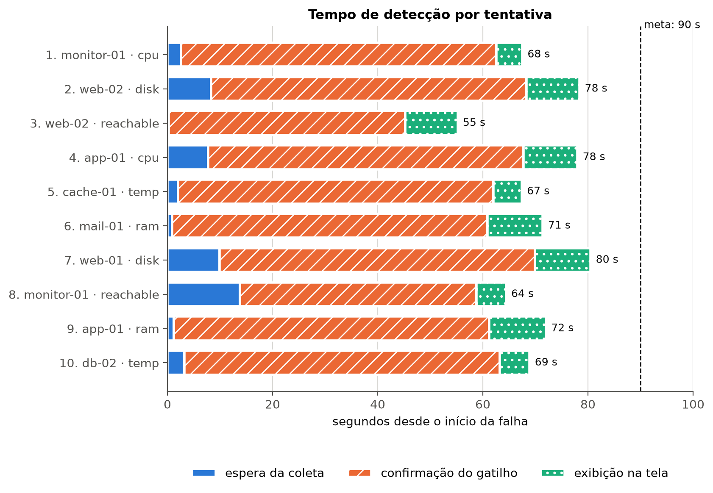
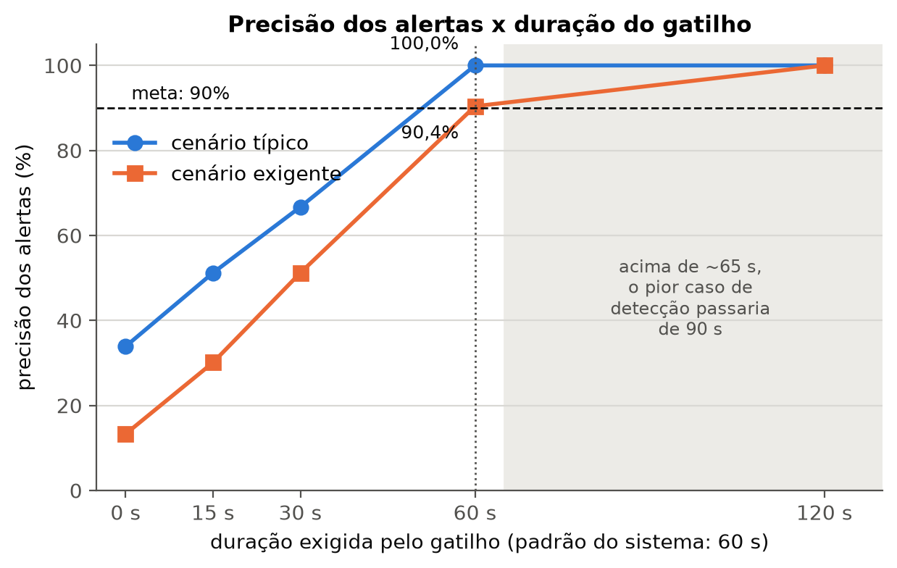
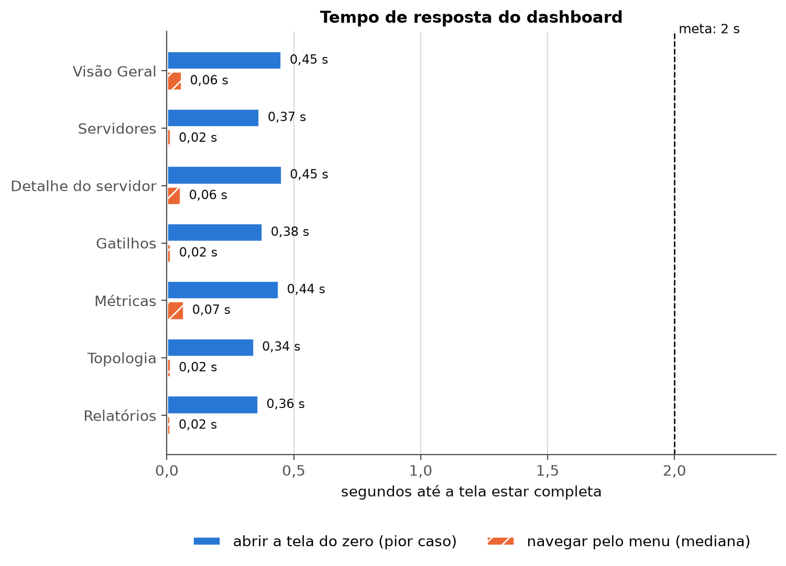
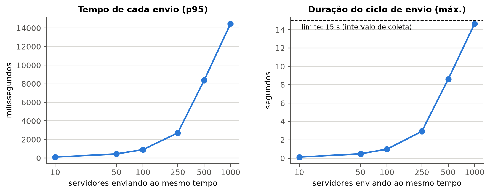

# Resultados dos testes do protótipo (etapa 6)

Documento gerado por `backend/evaluation/relatorio.py` a partir dos dados em `docs/resultados/dados/`. Cada teste pode ser refeito com o script indicado; os números abaixo mudam a cada execução, mas o método é o mesmo.

**Máquina dos testes:** Windows 10, AMD64 Family 25 Model 33 Stepping 2, AuthenticAMD, 16 núcleos lógicos, 31.9 GB de RAM, Python 3.12.10.

## Resumo: metas da seção 4.5

| Critério | Meta | Resultado | Situação |
| --- | --- | --- | --- |
| Tempo para detectar a falha | < 90 s | média 70,4 s, máximo 80,5 s (10 tentativas) | ✅ atingida |
| Precisão dos alertas | > 90% | cenário típico 100,0%; exigente 90,4% (críticos 100,0%) | ✅ atingida no típico; ✅ atingida no exigente |
| Consumo de recursos do agente | < 5% CPU e < 256 MB | PC: 0,03% de CPU, 25,7 MB | ✅ atingida |
| Tempo de resposta do dashboard | < 2 s | pior caso 0,46 s | ✅ atingida |
| Disponibilidade do monitoramento | 99% | medição curta demais (1 min); rodar `evaluation.disponibilidade` por 24 h | — |

## 1. Tempo de detecção de falhas

Script: `python -m evaluation.deteccao`

Falha injetada pelo coletor simulado; cronômetro até a linha do alerta aparecer na tela de Gatilhos do painel aberto no Microsoft Edge (build de produção, atualização a cada 10 s).

| Etapa | Média | Mínimo | Máximo |
| --- | --- | --- | --- |
| Espera da coleta (intervalo de 15 s) | 5,0 s | 0,2 s | 13,8 s |
| Confirmação do gatilho | 57,0 s | 45,0 s | 60,0 s |
| Exibição na tela (atualização a cada 10 s) | 8,4 s | 4,9 s | 10,8 s |
| **Total** | 70,4 s | 55,3 s | 80,5 s |

Depois que a falha termina, o alerta **resolve** em média em 69,6 s (máximo 124,9 s): a mesma duração é exigida para encerrar, o que evita alertas abrindo e fechando.

O tempo é praticamente determinado pela configuração: até 15 s de espera da coleta, a duração do gatilho (60 s; 45 s para queda do servidor) e até 10 s de atualização da tela. O pior caso teórico é 85 s.

## 2. Precisão dos alertas

Script: `python -m evaluation.precisao`

Cada execução passa 4 h de leituras de 10 servidores (uma a cada 15 s) pela ingestão e pelo motor de gatilhos reais, com 30 falhas reais (2 a 8 min) e 40 picos curtos (15 a 45 s), em 5 sementes aleatórias.

**Definição:** verdadeiro = alerta correspondente a uma falha real injetada (2 a 8 min acima do limite); falso = alerta por pico curto (15-45 s), ruído, perda de pacote ou repetido.

- **Cenário típico:** todos os servidores operam com folga em relação aos limites.
- **Cenário exigente:** 3 dos 10 servidores operam perto do limite de aviso, gerando ruído capaz de cruzá-lo sozinho.

| Duração do gatilho | Precisão (típico) | Precisão (exigente) | Falhas detectadas | Atraso médio |
| --- | --- | --- | --- | --- |
| **padrão do sistema (60 s; alcance 45 s)** | 100,0% | 90,4% (de 81,1 a 96,8%) | 100,0% | 56,8 s |
| 0 s | 33,9% | 13,3% (de 12,8 a 13,9%) | 100,0% | 0,0 s |
| 15 s | 51,2% | 30,1% (de 27,5 a 34,9%) | 100,0% | 15,0 s |
| 30 s | 66,7% | 51,2% (de 46,9 a 56,6%) | 100,0% | 30,0 s |
| 60 s | 100,0% | 90,4% (de 81,1 a 96,8%) | 100,0% | 60,0 s |
| 120 s | 100,0% | 100,0% (de 100,0 a 100,0%) | 96,7% | 120,0 s |

No cenário exigente, os alertas falsos restantes do padrão vieram de: {'pico_curto': 0, 'ruido': 16, 'repetido': 0, 'perda_de_pacote': 0}. Considerando só os alertas **críticos**, a precisão foi 100,0%.

**Leitura:** sem a confirmação por duração (0 s), quase todo pico vira alerta. A precisão sobe com a duração, mas o atraso também; acima de ~65 s o pior caso de detecção passaria de 90 s. Os 60 s do padrão são o maior valor que mantém as duas metas.

## 3. Tempo de resposta do dashboard

Script: `python -m evaluation.desempenho`

Microsoft Edge (headless), build de produção do painel, 7 dias de histórico de 10 servidores; cronômetro até haver conteúdo na tela e nenhum indicador de carregamento.

| Tela | Abrir do zero: mediana | Abrir do zero: máximo | Navegar pelo menu: mediana |
| --- | --- | --- | --- |
| Visão Geral | 434 ms | 454 ms | 61 ms |
| Servidores | 346 ms | 367 ms | 17 ms |
| Detalhe do servidor | 443 ms | 455 ms | 57 ms |
| Gatilhos | 345 ms | 379 ms | 18 ms |
| Métricas | 433 ms | 443 ms | 70 ms |
| Topologia | 340 ms | 345 ms | 17 ms |
| Relatórios | 355 ms | 362 ms | 16 ms |

Rotas da API usadas pelas telas:

| Rota | Mediana | p95 |
| --- | --- | --- |
| `GET /overview` | 5,4 ms | 5,9 ms |
| `GET /servers` | 3,0 ms | 3,2 ms |
| `GET /servers/{id}` | 2,1 ms | 2,3 ms |
| `GET /servers/{id}/metrics (4 séries, 24 h)` | 8,2 ms | 8,6 ms |
| `GET /servers/{id}/metrics (4 séries, 7 dias)` | 23,5 ms | 24,0 ms |
| `GET /alerts (100 mais recentes)` | 4,1 ms | 4,3 ms |
| `GET /triggers` | 1,5 ms | 1,7 ms |
| `GET /reports` | 1,4 ms | 1,5 ms |

## 4. Carga e estresse

Script: `python -m evaluation.carga`

N servidores simulados enviando 6 leituras cada, todos ao mesmo tempo, a cada 15 s; API com 1 processo, banco SQLite; o dashboard é consultado a cada 1 s durante a carga.

| Servidores | Leituras/ciclo | Envio p95 | Ciclo máx. | Dashboard p95 | CPU da API (média) | Memória da API | Dentro dos limites |
| --- | --- | --- | --- | --- | --- | --- | --- |
| 10 | 60 | 105 ms | 0,12 s | 7 ms | 2% | 99 MB | sim |
| 50 | 300 | 447 ms | 0,48 s | 32 ms | 5% | 106 MB | sim |
| 100 | 600 | 903 ms | 0,98 s | 48 ms | 9% | 112 MB | sim |
| 250 | 1500 | 2708 ms | 2,92 s | 276 ms | 21% | 131 MB | sim |
| 500 | 3000 | 8362 ms | 8,60 s | 3604 ms | 37% | 160 MB | não |
| 1000 | 6000 | 14466 ms | 14,65 s | 11247 ms | 59% | 225 MB | não |

Maior carga dentro dos limites (ciclo < 15 s, sem erros, dashboard p95 < 2 s): **250 servidores**.

## 5. Consumo de recursos do agente

Scripts: `python -m evaluation.recursos` (PC) e `bash vps_recursos.sh 60` (VPS)

| Onde | Processo | CPU (% de um núcleo) | Memória | Período |
| --- | --- | --- | --- | --- |
| PC | agente (smi_agent.py) | média 0,03%, máx 0,8% | média 25,2 MB, máx 25,7 MB | 10,0 min |

Na VPS o agente também roda com limites impostos pelo systemd (5% de CPU e 128 MB), abaixo das metas do TCC: o consumo medido fica bem longe desses limites.

## 6. Integração com a IA

Script: `python -m evaluation.ia`

Modelo: **ollama · qwen2.5:7b**. 7 perguntas com resposta conhecida, 3 vezes cada em conversa nova; conferência automática contra a API logo após cada resposta.

- Respostas corretas: **100,0%**
- Usou a ferramenta MCP adequada: 100,0%
- Respostas que citaram servidor inexistente: 0
- Tempo de resposta: mediana 4,1 s, máximo 6,0 s (o modelo já estava carregado na memória; logo após ligar o computador, a primeira resposta leva cerca de 55 s)
- Relatório com análise da IA: pronto em 12,0 s

| Pergunta | Acertos | Ferramenta adequada | Tempo mediano |
| --- | --- | --- | --- |
| Qual servidor está em pior estado e por quê? | 3/3 | 3/3 | 5,3 s |
| Quantos servidores estão em estado crítico agora? | 3/3 | 3/3 | 3,7 s |
| Quais servidores estão em estado de aviso? | 3/3 | 3/3 | 5,1 s |
| Qual é o uso de disco do srv-backup-01 agora? | 3/3 | 3/3 | 3,9 s |
| Existe algum alerta ativo no srv-web-01? | 3/3 | 3/3 | 1,4 s |
| Como está a temperatura do srv-app-02 nas últimas 6 horas? | 3/3 | 3/3 | 4,9 s |
| Quais são os limites de alerta de CPU que valem para o srv-db-01? | 3/3 | 3/3 | 2,7 s |

## 7. Testes funcionais

Script: `python -m evaluation.funcional`

| Área | Passaram |
| --- | --- |
| API REST (servidores, métricas, alertas, relatórios, visão geral) | 16/16 |
| Assistente de IA e servidor MCP | 15/15 |
| Concorrência (muitos envios simultâneos) | 1/1 |
| Motor de gatilhos | 12/12 |
| InfluxDB x SQLite | 0/1 (1 pulado: precisa de InfluxDB) |
| Servidores reais, watchdog e migração do banco | 9/9 |
| Coletor SNMP (cálculos) | 4/4 |
| Front-end: lint (ESLint) | ok |
| Front-end: build de produção (Vite) | ok |

## 8. Disponibilidade do serviço de monitoramento

Script: `python -m evaluation.disponibilidade --horas 24`

2 verificações em 0,0 h: **100,000%** disponível; 0 interrupção(ões).

## Observações da análise manual

Pontos observados lendo os dados e as respostas, que a conferência automática não cobre (atualize a cada nova rodada dos testes):

- **Resolução de 124,9 s (detecção, tentativa 2):** logo depois da falha de disco no `srv-web-02`, a tentativa seguinte deixou o mesmo servidor inalcançável. Sem leituras, o alerta de disco não tinha como confirmar o fim do problema e só resolveu quando os dados voltaram. É o comportamento esperado; nas demais tentativas a resolução ficou entre 50 e 70 s.
- **Exibição acima de 10 s (até 10,8 s):** a tela se atualiza a cada 10 s, e a esse intervalo soma-se o tempo da requisição e da renderização.
- **IA, horário errado:** em 1 das 21 respostas, a IA citou o horário da última leitura com 3 h de diferença (como se fosse UTC), embora a ferramenta MCP entregue os horários já no horário local. A conferência automática verifica servidores, quantidades e valores, mas não horários; esse foi o único erro de conteúdo encontrado na leitura das respostas.
- **IA, correção feita durante os testes:** na primeira rodada, a ferramenta de métricas enviava ao modelo as janelas vazias da agregação, e a IA interpretou isso como "falha na coleta". A ferramenta passou a enviar só os pontos com valor e a informar explicitamente as lacunas reais (mais de 10 min sem dados).
- **Carga, correção feita durante os testes:** a primeira rodada travou com 50 servidores, porque cada envio usava duas conexões do banco ao mesmo tempo. Depois da correção (uma conexão por envio e escrita em fila), a carga suportada passou de 10 para 250 servidores. O teste `tests/test_concorrencia.py` impede que o problema volte.

## Limitações dos testes

- Os testes de detecção, precisão, desempenho e carga usam o coletor simulado para provocar falhas sob demanda; a coleta real (agente e SNMP) foi validada separadamente na VPS (etapa 5).
- A precisão depende de quão perto dos limites os servidores operam; por isso há dois cenários.
- Os resultados da IA variam entre execuções (modelo de linguagem) e dependem do modelo usado.
- Banco de séries usado nos testes: SQLite (padrão do protótipo). O InfluxDB foi validado quanto à equivalência dos resultados (etapa 2).
